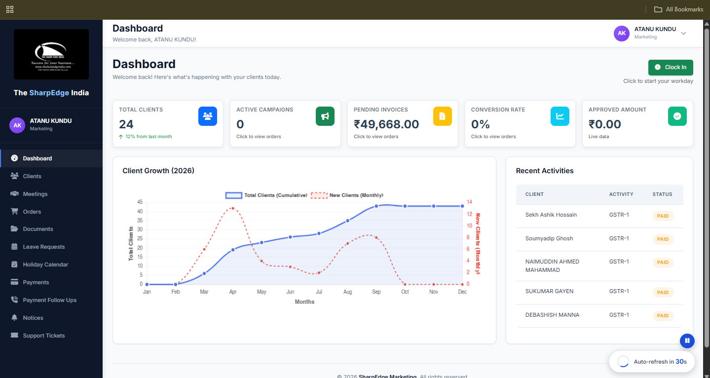

<h1>SharpEdge – CA Firm Management System</h1>

A <strong>Laravel-based management application</strong> for a <strong>Chartered Accountancy (CA) firm</strong>, designed to manage clients, service orders, invoices, payments, documents, financial operations, and staff workflows through separate role-based panels.

<h3>Key Features &amp; Panel Responsibilities</h3>

<h4>1. Admin Panel</h4>
<ul>
    <li>Manages <strong>clients, services, and service orders</strong>.</li>
    <li>Handles <strong>invoice management, payments, receipts, and payment follow-ups</strong>.</li>
    <li>Reviews and verifies documents, tasks, and leave requests.</li>
    <li>Monitors business activities, reports, and workflow status.</li>
</ul>

<h4>2. Marketing Panel</h4>
<ul>
    <li>Manages client coordination, meetings, and service orders.</li>
    <li>Tracks <strong>invoices, payments, pending dues, and payment follow-ups</strong>.</li>
    <li>Handles client documents, support tickets, and leave requests.</li>
    <li>Monitors client activity through dashboard statistics.</li>
</ul>

<h4>3. Back Office Panel</h4>
<ul>
    <li>Handles <strong>financial computations and accounting operations</strong>.</li>
    <li>Works with <strong>balance sheets, profit and loss statements, trading accounts, and financial reports</strong>.</li>
    <li>Supports reconciliation of assets, debtors, creditors, bank, sales, and purchases.</li>
    <li>Manages assigned tasks, financial documents, and payment follow-ups.</li>
</ul>

<h4>4. Client Panel</h4>
<ul>
    <li>Allows clients to track <strong>service orders and order status</strong>.</li>
    <li>Provides access to <strong>invoices, payment details, and billing information</strong>.</li>
    <li>Supports document submissions and support ticket creation.</li>
</ul>

<h3>How the System Works</h3>

The <strong>Admin Panel</strong> oversees client management, service orders, invoices, and payments. The <strong>Marketing Panel</strong> manages client coordination, invoice tracking, and payment follow-ups. The <strong>Back Office</strong> handles accounting operations, financial computations, and reports. Clients use their dedicated panel to track services, access invoices, view payment information, submit documents, and raise support requests.

<h3>System Preview</h3>

<table>
    <tr>
        <td align="center" width="50%">
            <strong>Admin Dashboard</strong>  
            
        </td>
        <td align="center" width="50%">
            <strong>Admin Service Selling</strong>  
            
        </td>
    </tr>
    <tr>
        <td align="center" width="50%">
            <strong>Admin All Orders</strong>  
            
        </td>
        <td align="center" width="50%">
            <strong>Marketing Dashboard</strong>  
            
        </td>
    </tr>
    <tr>
        <td align="center" width="50%">
            <strong>Back Office Dashboard</strong>  
            
        </td>
        <td align="center" width="50%">
            <strong>Client Dashboard</strong>  
            
        </td>
    </tr>
</table>

<h3>Tech Stack</h3>

<strong>PHP, Laravel, MySQL, Blade, JavaScript, AJAX, HTML, CSS</strong>

<h3>Contributions</h3>

Developed and maintained <strong>role-based workflows, CRUD modules, AJAX interactions, invoice and payment tracking, document management, service order management, and financial computation features</strong>.

